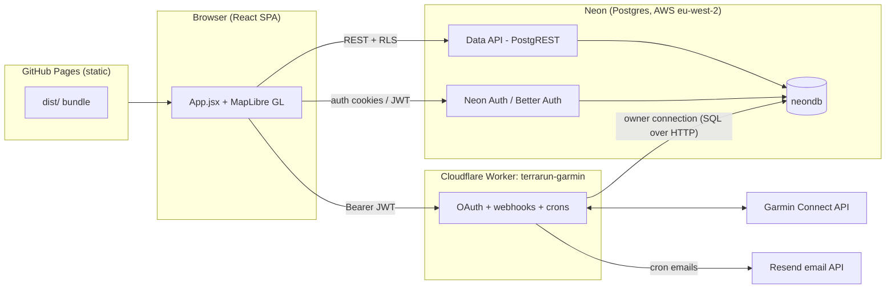

# TerraRun — Engineering Document

**Version:** 0.2.0 · **Live:** https://dimaklit.github.io/TerraRun/ · **Repo:** `dimaklit/TerraRun`

---

## 1. Game concept

TerraRun is a **territory-control game for runners**. The city is the board; your runs are the moves.

### Core loop
1. **Run** a route in the real world (GPS-tracked by a watch or phone).
2. **Import** it into TerraRun — manually (GPX/GeoJSON file) or automatically (Garmin sync).
3. If the route **encloses an area** — a closed loop, or a track that crosses itself — the enclosed polygon becomes **your territory**, painted in your color on the map.
4. **Defend and conquer.** Territories have *strength*:
   - every additional run of yours over an area → **+1 strength** (rendered as taller 3D towers);
   - a rival's run over your area → **−1 strength** in the overlap only;
   - at strength 0 the fragment turns neutral; the next run over it captures it.
5. Rivals are **anonymous**: other players appear only as a stable color and a codename (`Rival 7F4B`). Nobody ever sees another player's name, email, or raw GPS track — only the claimed polygons.

### Design principles
- **Privacy first.** Routes are private; only claim polygons are shared, with no identity attached.
- **Honest effort.** Anti-cheat speed filter: sustained movement above 35 km/h (vehicles) claims nothing, while isolated GPS spikes are tolerated (median-of-3 smoothing + >10 s sustained rule).
- **Partial combat.** Geometry is split precisely: only the overlapping fragment of a territory is contested; the rest is untouched.
- **Zero cost, zero ads.** Free hosting/infrastructure tiers end-to-end.

### Future ideas (not implemented)
Territory decay over time · leaderboards across players · team/clan mode · Strava sync · route quests ("capture this district").

---

## 2. Architecture



| Component | Technology | Hosting | Cost |
|---|---|---|---|
| Frontend | React 18 + Vite 6, MapLibre GL 5, Turf.js 7 | GitHub Pages | free |
| Auth | Neon Auth (Better Auth), email+password | Neon | free tier |
| Database | Postgres 18 (`neondb`, project `dawn-paper-97073551`) | Neon, AWS eu-west-2 | free tier |
| Client data access | Neon Data API (PostgREST) + Row Level Security | Neon | free tier |
| Backend | Cloudflare Worker `terrarun-garmin` | Cloudflare | free tier |
| Activity sync | Garmin Connect Developer Program (Starter, Activity API) | — | free |
| Email | Resend (`onboarding@resend.dev` → owner address) | — | free tier |
| CI/CD | GitHub Actions (`.github/workflows/pages.yml`) | GitHub | free |

### Key URLs
- App: `https://dimaklit.github.io/TerraRun/` (also `/guide.html`, `/privacy.html`)
- Neon base URL (client): `https://ep-wandering-resonance-zamaapvp.c-2.eu-west-2.aws.neon.tech/neondb`
  — `@neon/neon-js` derives from it the Auth host (`…neonauth…/neondb/auth`) and the Data API host (`…apirest…/neondb/rest/v1`)
- Worker: `https://terrarun-garmin.dima-klit.workers.dev`

---

## 3. Data model (Postgres)

All game tables live in `public`; auth tables in `neon_auth` (managed by Neon Auth).

### `private_activities` — the player's own routes
| column | type | notes |
|---|---|---|
| id | uuid PK | |
| user_id | text | defaults to `auth.user_id()` |
| activity_key | text | dedupe key: `<email>:<sha256(coords+times+name)>` — hashed so it fits btree limits |
| route | jsonb | full route object (coordinates, name, color, metrics) |
| claim | jsonb/null | captured polygon + area; null for flagged/open routes |
| recorded_at | timestamptz | |
- unique `(user_id, activity_key)`
- **RLS:** select/insert own rows only (`auth.user_id() = user_id`)

### `shared_claims` — anonymous combat layer
| column | type | notes |
|---|---|---|
| user_id | text | **never exposed** to clients |
| claim_key | text | same dedupe key |
| claim | jsonb | `{ polygon, areaSqKm }` only — no names |
| recorded_at | timestamptz | combat is replayed chronologically |
- **RLS:** insert own only; **no select grant on the table**
- Read via view **`shared_claims_feed`** (owner rights): exposes `id, owner_token = md5(user_id), mine = (user_id = auth.user_id()), claim, recorded_at`

### `garmin_connections` — OAuth tokens (worker-only)
`user_id PK, garmin_user_id unique, access_token, refresh_token, expires_at`.
RLS enabled, **zero grants** — only the worker (owner connection) touches it.
View `garmin_link_status` lets a client check *whether* they are linked (own row only).

### `external_activities` — Garmin inbox
`user_id, provider, external_id, name, geojson, recorded_at, imported_at`.
Worker inserts; client selects own pending rows (`imported_at is null`), imports them through the normal pipeline, then updates `imported_at`.
RLS: select own; update own (`imported_at` column grant only).

### `admin_state` — worker bookkeeping
`key PK, value` — e.g. `last_user_notified_at` for signup notifications. No grants.

### Migrations
`neon/migrations/*.sql`, applied manually (SQL editor or owner connection). After DDL changes, **refresh the Data API schema cache** in the Neon console or PostgREST won't see new tables.

---

## 4. Frontend logic (`src/`)

### Module map
| file | responsibility |
|---|---|
| `main.jsx` → `AuthGate.jsx` | session check, sign-in / sign-up (nickname, email, password) |
| `App.jsx` | map, panels, import flow, state orchestration |
| `utils/neon.js` | `createClient(VITE_NEON_DATABASE_URL)`; null → demo mode |
| `utils/geo.js` | GPX/GeoJSON parsing → routes with coords, times, **sha256 activityKey** |
| `utils/routeMetrics.js` | distance, closure detection (50 m tolerance), captured polygon (self-intersection → `polygonize`), **speed assessment** |
| `utils/territoryControl.js` | strength combat engine (`applyTerritoryActivity`), visible/rival territory selection |
| `utils/sharedClaims.js` | publish own claims, load rivals, color/codename from `owner_token` |
| `utils/activityStore.js` | load/save `private_activities` |
| `utils/garmin.js` | worker API calls (JWT from `/auth/token`), pending-activity import |
| `utils/routeFilters.js`, `routeDisplay.js` | period filters, colors |

### Import pipeline (both manual file and Garmin)
```
File/GeoJSON → parseRouteFile → extractRouteGeometries (Multi/LineString + times)
  → calculateRouteMetrics:
      speed profile → median-of-3 smoothing → flagged if >35 km/h sustained >10 s or >50 % of run
      closure check (≤50 m start/finish) or self-intersection → captured polygon (Turf polygonize)
  → dedupe by activityKey → savePrivateActivities → publishClaims (anonymous)
  → state update → map fitBounds
```

### Combat engine (`territoryControl.js`)
Event-sourced: all claims (own + rival), sorted by `recorded_at`, are replayed through
`applyTerritoryActivity`. Each step splits existing territories with Turf `intersect`/`difference`:
- same owner on overlap → `strength + 1`
- different owner → `strength − 1`; at 0 → neutral (`username: null`)
- the non-overlapping remainder of the new claim becomes a new territory, strength 1

Rendering: own territories (filtered by selected routes) + all rival-owned territories; strength drives
3D tower height (`strength × 12 m`).

### Anonymity mapping
`shared_claims_feed` row → activity `{ username: 'rival:<owner_token>', name: 'Rival <TOK4>', color: hsl(hash(token) % 360, 82%, 58%) }`.
The token is an md5 of the user id — stable across devices, not reversible to an identity.

### Map
MapLibre GL + OpenFreeMap vector tiles (Positron default). RTL plugin (`@mapbox/mapbox-gl-rtl-text`,
self-hosted via Vite `?url`) renders Hebrew/Arabic labels correctly. Hidden `GeolocateControl`
(triggered by the crosshair button) shows the pulsing location dot and tracks the user.
Version badge from `package.json` via Vite `define: __APP_VERSION__`.

---

## 5. Backend logic (Cloudflare Worker, `worker/src/`)

| file | responsibility |
|---|---|
| `index.js` | HTTP routes + scheduled (cron) handler |
| `state.js` | PKCE pair, AES-GCM-sealed OAuth `state` (10-min TTL) |
| `fit.js` | FIT records → GeoJSON LineString with `coordinateProperties.times` |
| `admin.js` | signup notifications + daily stats emails (Resend) |

### HTTP interface
| route | method | auth | purpose |
|---|---|---|---|
| `/garmin/connect` | POST | Neon JWT (JWKS-verified, EdDSA) | returns Garmin authorize URL (PKCE) |
| `/garmin/callback` | GET | sealed `state` param | code→token exchange, stores `garmin_connections`, redirects to site with `?garmin=connected\|denied\|error` |
| `/garmin/webhook/<secret>` | POST | path secret | Garmin pushes `activityFiles`; worker downloads FIT with the user's token, converts, inserts `external_activities` (`ctx.waitUntil`) |
| `/garmin/deregister/<secret>` | POST | path secret | deletes the user's `garmin_connections` row |
| `/garmin/connection` | DELETE | Neon JWT | user-initiated disconnect |

The webhook secret lives in the **path** because Garmin's endpoint configuration strips query strings.
CORS is restricted to `ALLOWED_ORIGIN`.

### Scheduled (cron)
| cron | job |
|---|---|
| `*/15 * * * *` | `notifyNewUsers` — users with `createdAt > admin_state.last_user_notified_at` → email digest, advance the marker |
| `0 4 * * *` | `sendDailyStats` — totals/24h: users, activities, Garmin links & pushes, shared claims, claimed km² |

### Configuration
- **Vars** (`wrangler.toml`): `SITE_URL`, `ALLOWED_ORIGIN`, `WORKER_URL`, `NEON_AUTH_JWKS_URL`, `NOTIFY_EMAIL`
- **Secrets** (`wrangler secret put`): `DATABASE_URL` (owner pooler connection), `GARMIN_CLIENT_ID`, `GARMIN_CLIENT_SECRET`, `STATE_SECRET`, `WEBHOOK_SECRET`, `RESEND_API_KEY`

---

## 6. External interfaces

### Neon Auth (Better Auth) — used by the client
- `POST …/auth/sign-up/email` `{ name, email, password }` (via `client.auth.signUp.email`)
- `POST …/auth/sign-in/email`, `POST …/auth/sign-out`, `GET …/auth/get-session`
- `GET …/auth/token` → `{ token: <JWT> }` (RS/EdDSA, `sub` = user id) — used as Bearer for the worker
- `GET …/auth/.well-known/jwks.json` — key set the worker verifies against
- Trusted origins: `https://dimaklit.github.io` + localhost (console → Auth settings)

### Neon Data API (PostgREST) — used by the client
`GET/POST/PATCH https://…apirest…/neondb/rest/v1/<table>` with `Authorization: Bearer <session JWT>`
(injected automatically by `@neon/neon-js`). RLS enforces per-user access; 409 on duplicate inserts
is treated as benign dedupe.

### Garmin Connect (Starter access)
- OAuth2 + PKCE: authorize `connect.garmin.com/oauth2Confirm`, token `diauth.garmin.com/di-oauth2-service/oauth/token`
- `GET apis.garmin.com/wellness-api/rest/user/id` → Garmin user id
- Push: Garmin POSTs activity-file notifications; FIT downloaded from `callbackURL` with the user token
- Limits: push-only (no history), ≤1000 connected users; endpoints configured at `apis.garmin.com/tools/endpoints`

### Resend
`POST https://api.resend.com/emails` — from `onboarding@resend.dev` to `NOTIFY_EMAIL` (free tier: owner's address only, 100/day).

---

## 7. Build, deploy, operations

- **Frontend:** push to `master` → GitHub Actions (`pages.yml`): `npm ci`, `npm test` (Node test runner, 40 tests), `npm run build` (env: `VITE_NEON_DATABASE_URL`, `VITE_GARMIN_WORKER_URL` from repo variables), deploy to Pages.
- **Worker:** `cd worker && npx wrangler deploy` (manual).
- **Migrations:** run SQL from `neon/migrations/` with the owner connection, then refresh the Data API schema cache.
- **Monitoring:** daily stats email; `npx wrangler tail` for live worker logs; Neon console → SQL editor for data inspection.
- **Windows dev quirk:** use `npm.cmd` / `npx.cmd` (PowerShell execution policy blocks `npm`).

### Known limitations / tech debt
- Main JS bundle ≈ 1.6 MB (MapLibre + Turf) — code-splitting candidate.
- Combat replays all shared claims client-side on every load — fine for dozens of players, needs server-side aggregation at scale.
- Shared claims are published forever (no decay/cleanup yet).
- Single Garmin provider; `provider` column is ready for Strava etc.
- Nickname is set at signup only (no profile editing UI yet) and is not unique.
