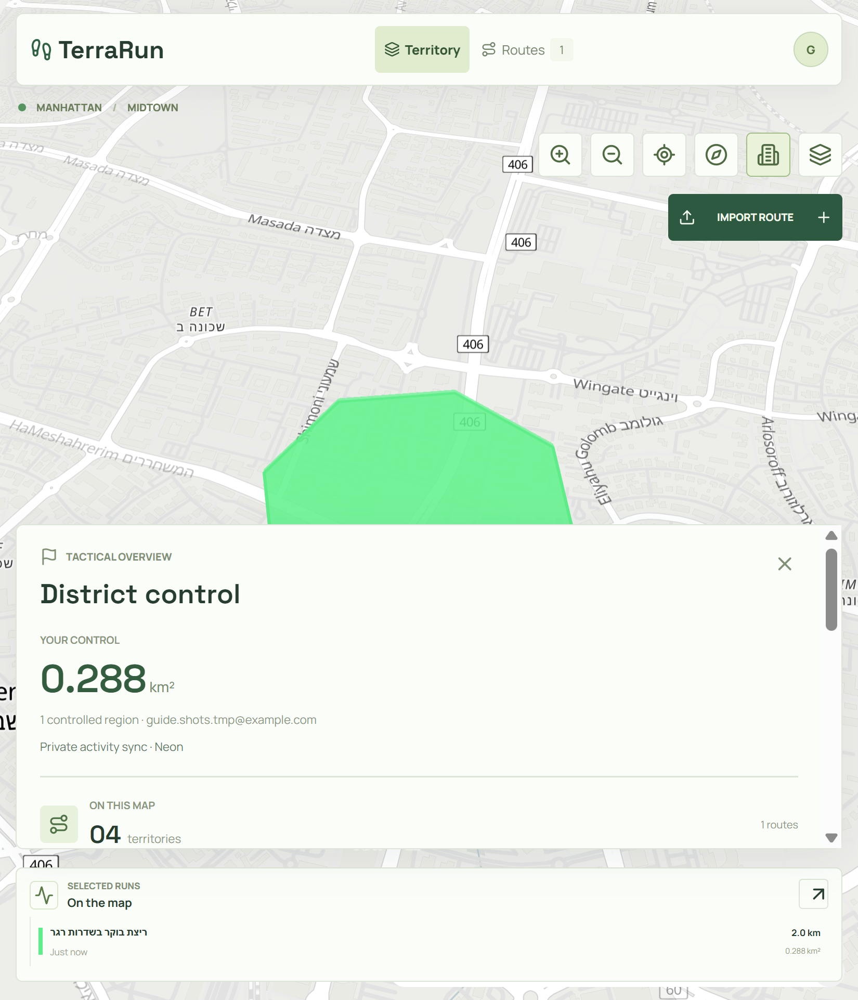
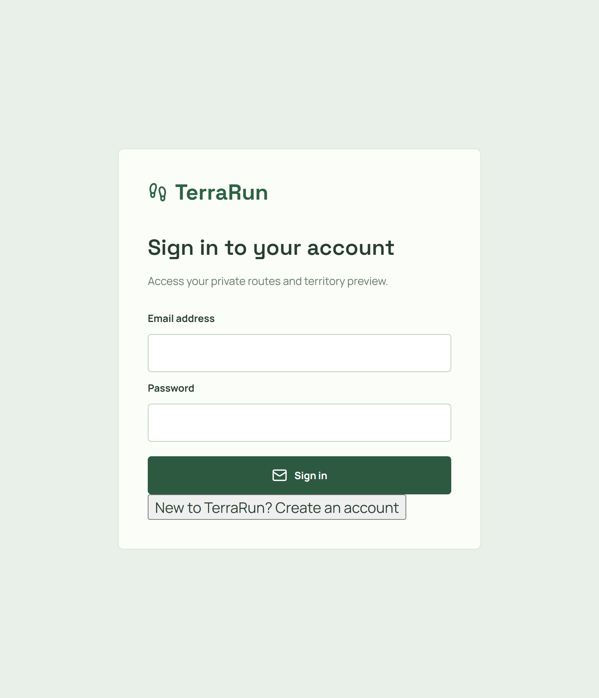
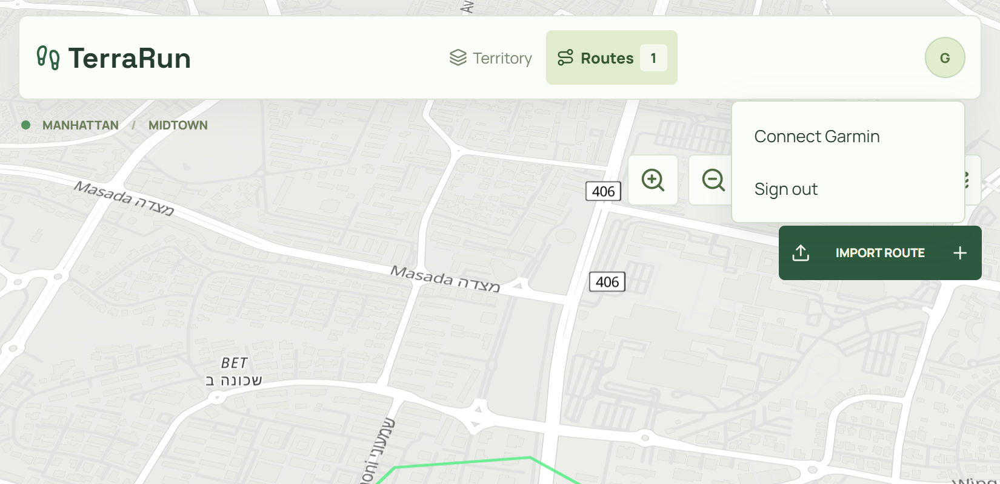

# TerraRun — Own Your City, One Run at a Time

**Play now:** https://dimaklit.github.io/TerraRun/ · **How to play (Hebrew):** [guide](https://dimaklit.github.io/TerraRun/guide.html)

---

## 1. What is TerraRun?

TerraRun turns every run into a land grab. Your city becomes the game board: run a loop around a park, a block, or your whole neighborhood — and the area you enclosed becomes **your territory**, painted in your color on a live 3D map.

But territory isn't yours forever. Other runners are out there, and every time one of them runs across your land, your grip on it weakens. Stop running — and your empire crumbles. Keep running — and watch your towers grow.

> **Run. Claim. Defend.**

*A 2 km morning loop = 0.288 km² of captured city.*

---

## 2. Why runners love the idea

- 🎯 **A reason to go out today.** Someone might be eating your territory right now. The game gives every ordinary run a mission: patrol the borders, reinforce the core, raid a new block.
- 🗺️ **Your runs finally add up to something.** Instead of a list of GPX files, you get a living map of everything you've conquered — with 3D towers that grow taller every time you re-run an area.
- ⚔️ **Real competition, zero awkwardness.** Rivals are completely anonymous: you see that *someone* took your corner of the park — a color and a codename like `Rival 7F4B` — but never who. No profiles to stalk, no pressure, pure game.
- 🏃 **Fair play built in.** Driving a car around the block claims nothing — the game detects vehicle speeds and rejects them. Only real legs win land.
- 🆓 **Free. No ads. No tracking.** A passion project, not a data business.

---

## 3. How it works — three steps

### Step 1 — Sign up in 30 seconds
Pick a nickname, enter an email and password. Done.

### Step 2 — Add a run
Two ways:
- **Drop a file** — export GPX from any watch or app and import it.
- **Connect Garmin** — one click, and every future run appears in the game automatically, seconds after you sync your watch.

### Step 3 — Claim and defend
Close the loop (finish near where you started, or cross your own path) and the enclosed area is yours. Then the real game begins:

| You do | Game says |
|---|---|
| Run a closed loop | 🟩 Territory captured |
| Run the same area again | 💪 Strength +1 — taller tower, harder to steal |
| A rival runs across your land | ⚠️ Strength −1 in the overlap — only the contested part |
| Your strength hits zero | ⚪ Land turns neutral — next runner takes it |

---

## 4. Privacy, in plain words

- Your routes, times and places are **visible only to you**.
- Other players see **only the shape of claimed areas** — never your name, email, or where exactly you ran within them.
- Garmin connection shares only activity files with the game, and you can disconnect at any time.
- Full privacy policy: https://dimaklit.github.io/TerraRun/privacy.html

---

## 5. Where it's going

The game is live and playable today (v0.2.0). On the drawing board:

- 🏆 **Leaderboards** — biggest empire in the city, most contested block of the week.
- ⏳ **Territory decay** — land you haven't visited for weeks slowly fades, keeping the map alive.
- 👥 **Teams & clans** — claim districts together with your running crew.
- 📱 **Strava sync** and more watch brands.
- 🎯 **Quests** — "capture the old town this month" challenges.

---

## 6. For partners & running communities

TerraRun is a lightweight way to make group running sticky:

- **Running clubs** — instant club turf wars: which group controls the riverfront?
- **Race organizers** — a playful layer for training season before the big event.
- **Workplace wellness** — office vs. office, floor vs. floor, on the real city map.

It runs entirely in the browser — nothing to install, works on any phone or laptop, in any country, with full right-to-left language support on the map.

**Contact:** Dmitry Kliteynik · github.com/dimaklit/TerraRun

---

*TerraRun — because the city belongs to whoever runs it.* 🏃‍♂️🏙️
